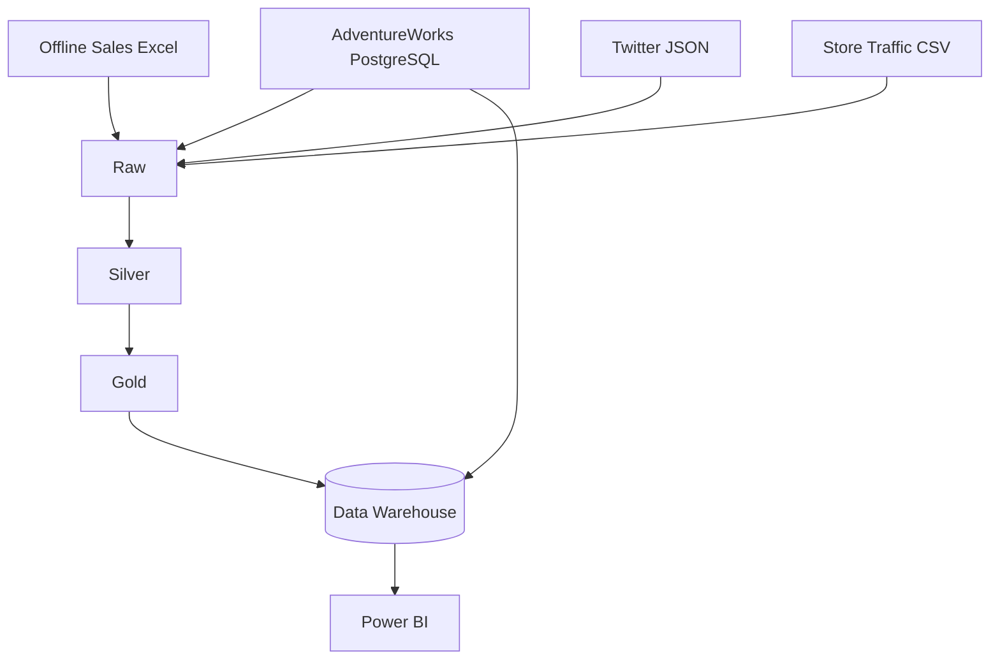
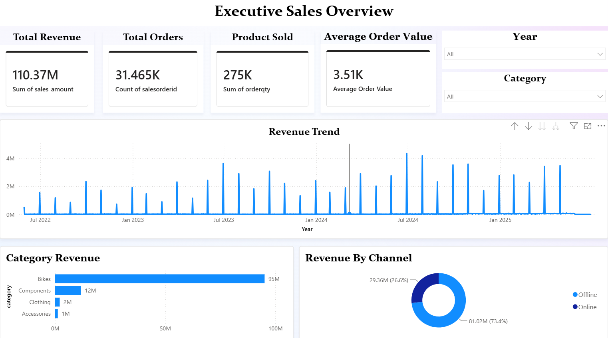
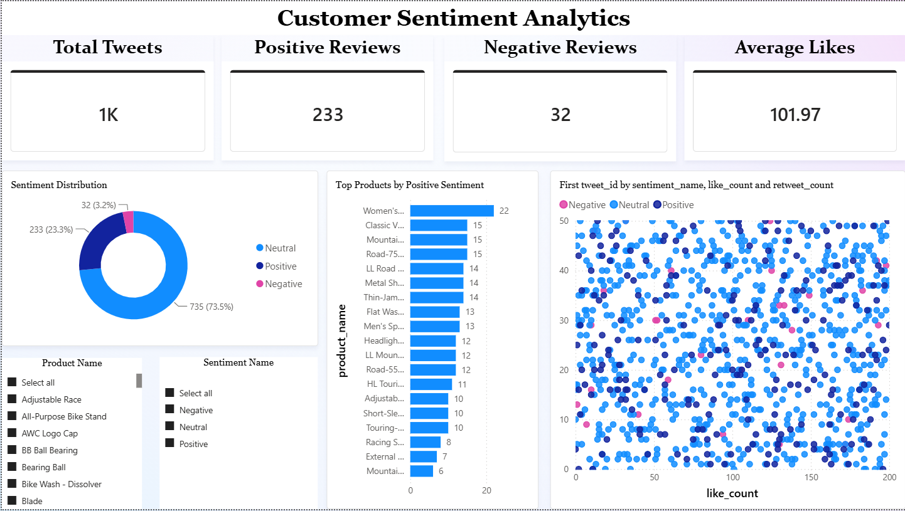
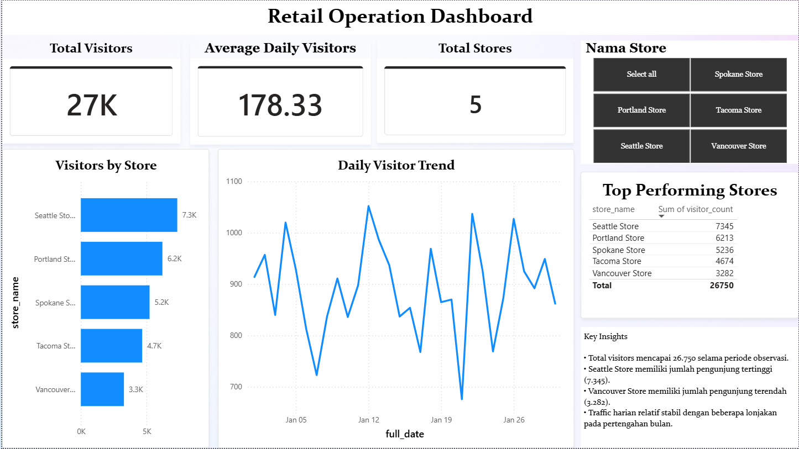

# Data Lakehouse AdventureWorks

Proyek akademik (tim) mata kuliah Data Lakehouse, Kelompok 10, Kelas D, 2025/2026.

Membangun Data Lakehouse dengan pendekatan **Medallion Architecture (Raw, Silver, Gold)** yang mengintegrasikan data dari PostgreSQL, Excel, JSON, dan CSV, lalu memuatnya ke **Data Warehouse (Galaxy Schema)** dan memvisualisasikannya di **Power BI**.

## Arsitektur



## Sumber Data

| Sumber | Format | Keterangan |
|---|---|---|
| Online Sales | PostgreSQL | Transaksi online dari database AdventureWorks |
| Offline Sales | Excel (.xlsx) | Diekstrak dari AdventureWorks (`onlineorderflag = false`) untuk mensimulasikan data cabang |
| Twitter Review | JSON (30 file harian) | Data **sintetis** hasil script generator |
| Store Traffic | CSV | Data **sintetis** hasil script generator |

> Data Twitter dan Store Traffic dibangkitkan secara acak dan bukan data operasional nyata.

## Struktur Repo

```
.
├── main.py                  # membuat struktur folder lake/
├── ingest_*.py              # Raw    : ingest_excel, ingest_twitter, ingest_traffic
├── store_*.py               # Silver : store_excel, store_json, store_csv
├── view_*.py                # Gold   : view_sales, view_twitter, view_traffic
├── load_dim_*.py            # DW     : load_dim_product, load_dim_customer
├── load_fact_sales.py       # DW     : fact_sales (channel Online)
├── analyst_*.py             # DW     : analyst_sales (Offline), analyst_twitt, analyst_traffic
├── docs/images/             # screenshot dashboard Power BI
└── lake/
    ├── raw/    (excel, json/twitter, csv/traffic)
    ├── silver/ (excel, json, csv)  -> format Parquet
    └── gold/   (sales, twitter, traffic)
```

## Output per Layer

| Layer | Proses | Output |
|---|---|---|
| Raw | Ambil data apa adanya dari sumber | `sales_offline.xlsx`, `twitter_day_1..30.json`, `store_traffic.csv` |
| Silver | Hapus duplikat, sesuaikan tipe data, konversi ke Parquet | `sales_offline.parquet`, `twitter.parquet`, `store_traffic.parquet` |
| Gold | Hitung `sales_amount`, klasifikasi sentimen, agregasi traffic | `sales_mart`, `tweet_sentiment`, `product_review_summary`, `product_ranking`, `traffic_summary` (`.parquet`) |

## Data Warehouse (Galaxy Schema)

- **Fact table:** `fact_sales`, `fact_twitter_sentiment`, `fact_store_traffic`
- **Dimension table:** `dim_customer`, `dim_product`, `dim_date`, `dim_sentiment`, `dim_store`
- Dimensi bersama: `dim_date` (ketiga fact) dan `dim_product` (`fact_sales` dan `fact_twitter_sentiment`).

> TODO: tambahkan file SQL (DDL dan seed) untuk membuat schema `dw` beserta tabel `dim_date`, `dim_store`, `dim_sentiment`.

## Cara Menjalankan

**Prasyarat**
- Python 3.10+
- PostgreSQL dengan database `staging_db` (AdventureWorks) dan `adventureworks_dw` (schema `dw`)

**Setup**
```bash
pip install -r requirements.txt
```
Sesuaikan koneksi database (host, user, password) di script yang memakai `psycopg2` atau `create_engine`.

**Urutan eksekusi**
```bash
python main.py                  # 1. buat folder lake/

python ingest_excel.py          # 2. Raw
python ingest_twitter.py
python ingest_traffic.py

python store_excel.py           # 3. Silver
python store_json.py
python store_csv.py

python view_sales.py            # 4. Gold
python view_twitter.py
python view_traffic.py

python load_dim_product.py      # 5. Data Warehouse (dimensi dulu, baru fact)
python load_dim_customer.py
python load_fact_sales.py       #    penjualan online
python analyst_sales.py         #    penjualan offline
python analyst_twitt.py
python analyst_traffic.py
```
Setelah itu, hubungkan Power BI ke database `adventureworks_dw`.

## Dashboard Power BI

Tiga dashboard dibangun di atas Data Warehouse (`adventureworks_dw`).

### Sales


KPI penjualan, tren revenue bulanan, kontribusi revenue per kategori produk (Bikes terbesar), dan perbandingan channel online vs offline.

### Sentiment


Analisis 1.000 tweet simulasi: 73,5% netral, 23,3% positif, 3,2% negatif, beserta produk dengan sentimen positif terbanyak dan hubungan antara jumlah like dan retweet.

### Store Traffic


Jumlah pengunjung 5 toko cabang (data simulasi). Seattle Store tertinggi (sekitar 7,3 ribu), Vancouver Store terendah (sekitar 3,3 ribu), dengan tren harian yang relatif stabil.

## Tim

Kelompok 10, Kelas D. _Isi nama anggota dan peran._
